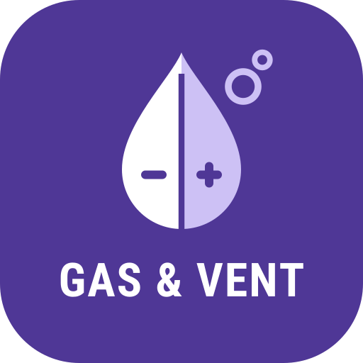

# TIMPEX ABG

Bedside arterial blood gas reader for when electrolytes aren't back: uses only pH, PaCO₂, PaO₂, HCO₃ (optional), FiO₂ and age.

- **Interpretation** in the form "Severe metabolic acidosis with concomitant respiratory alkalosis", from pH, pCO₂ and HCO₃ only. The traditional label (uncompensated / partially / fully compensated) is shown for reference.
- **Compensation** written out line by line: Winter's formula, metabolic alkalosis formula, acute and chronic respiratory rules.
- **Desired FiO₂** by the a/A ratio method, with nasal cannula flow, P/F ratio and A-aDO₂. The Auto target is 104 − 0.4 × age, pO₂ 60 with CO₂ retention (SpO₂ 88–92%), or pO₂ 65 when ventilated with P/F ≤ 300 (ARDSNet 55–80). If pO₂ is already adequate or in the target window, it says "keep" instead of changing the oxygen.
- **HCO₃ deficit** = 0.5 (or 0.4) × weight × (24 − HCO₃).
- **Message to copy**: values with ⬇️/⬆️, P/F, A-aDO₂, desired FiO₂, HCO₃ deficit, compensation and interpretation.
- Accepts TCO₂, BE and SO₂ from the printout; flags an HCO₃ or TCO₂ that doesn't fit pH and pCO₂.
- **Complete interpretation**: acid–base + oxygenation, traditional label, Type 1/Type 2 respiratory failure, and gas exchange (P/F, A-aDO₂ or a/A with the likely mechanism).
- **Guideline-based suggestions** at the end of the message: BTS 2017 (O₂ targets), GOLD 2026 and NICE (NIV), Surviving Sepsis Campaign 2026 and BICARICU-2 (bicarbonate, lactate), ADA/EASD 2024 (DKA), 2023 global ARDS definition and ATS 2024 (ARDS), MSD Manual (metabolic alkalosis).
- Optional lactate, and a CO₂-retainer tick box (SpO₂ 88–92%, desired FiO₂ for pO₂ 60).
- **Support modes**: room air, nasal cannula (L/min), mask/HFNC, NIV (BiPAP/CPAP) and mechanical ventilation, each with its own fields, desired FiO₂ wording and suggestions. On the ventilator: predicted body weight, VT per kg, minute ventilation, driving pressure, oxygenation index, and the RR needed to reach a target pCO₂, using the ARDSNet pH 7.30–7.45 rule when P/F ≤ 300 (BTS/ICS 2016, ERS 2022, ARDSNet, SSC 2026, ATS 2024, UK-ROX 2025, Amato NEJM 2015).

Works offline once opened, and picks up updates on the next open when there is signal; install it from Safari (Share → Add to Home Screen) or Chrome (Install app).

References: Berend K et al. N Engl J Med 2014;371:1434–45 · Shapiro BA et al. Clinical Application of Blood Gases, 5th ed. · Gilbert R, Keighley JF. Am Rev Respir Dis 1974;109:142–5.

Clinical decision aid for trained clinicians. It does not replace clinical judgment or your institution's protocols.
